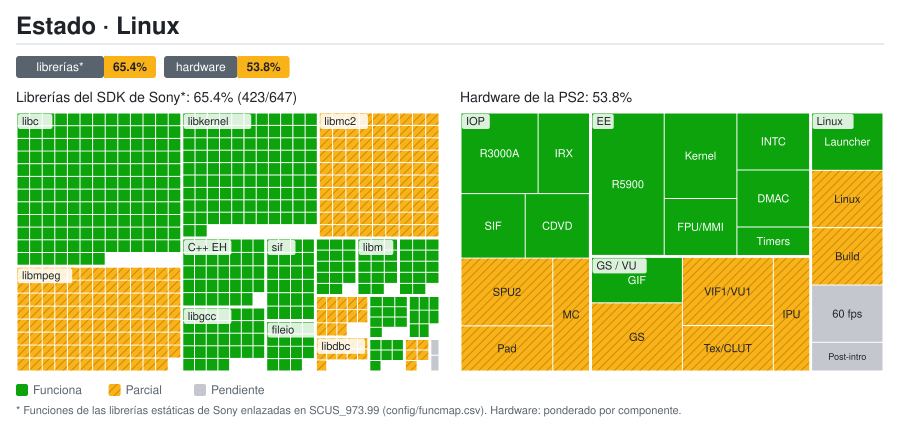
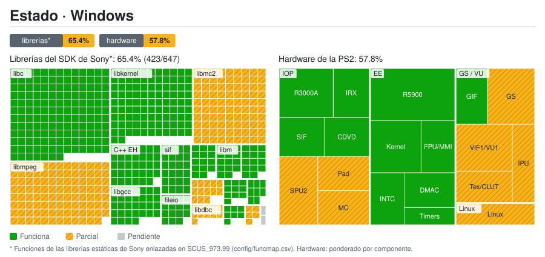
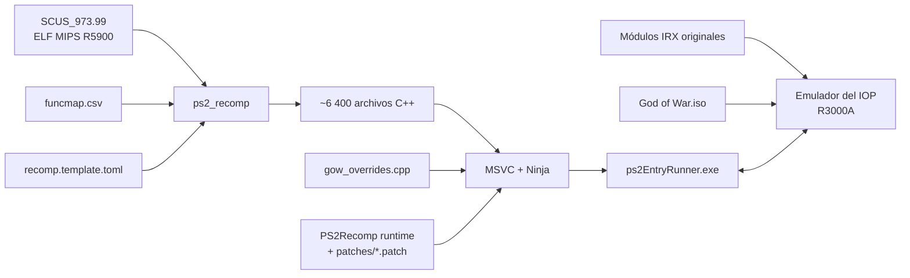

<div align="center">

# God of War — PS2 Static Recompilation

[English](README.md) · **Español** · [Português (Brasil)](README.pt-BR.md)

**Port nativo para PC de *God of War* (PS2, NTSC-U `SCUS-97399`) mediante recompilación estática de MIPS R5900 a C++.**


[](https://github.com/KIexster/god-of-war-recomp/actions/workflows/pruebas.yml)

</div>

---

> [!IMPORTANT]
> Este repositorio **no contiene ningún archivo del juego** (ISO, ejecutable, módulos IRX ni datos `.PAK`)
> ni el código C++ generado a partir de él. Necesitas **tu propia copia legal** de God of War para PS2.

## Índice

- [Propósito y objetivos](#propósito-y-objetivos)
- [Mapa de estado](#mapa-de-estado)
- [Qué es](#qué-es)
- [Estado actual](#estado-actual)
- [Linux (port nativo)](#linux-port-nativo)
- [Estructura del repositorio](#estructura-del-repositorio)
- [Requisitos](#requisitos)
- [Compilar y ejecutar](#compilar-y-ejecutar)
- [Cómo funciona](#cómo-funciona)
- [Documentación](#documentación)
- [Créditos y licencia](#créditos-y-licencia)

## Propósito y objetivos

Un **port nativo y jugable de *God of War* (2005) para Linux** mediante recompilación estática, sobre
[PS2Recomp](https://github.com/ran-j/PS2Recomp). Hitos, en orden:

1. **60 FPS estables** en partida.
2. Renderizado a **1080p** con escalado.

Estado actual, con honestidad: el juego arranca desde tu propia ISO, reproduce la intro, llega a la partida y
guardar funciona, pero en partida va a solo **~20-30 FPS** (RTX 5050), lejos de 60. Problemas conocidos: algunos
fallos visuales en orbes y partículas, un cuelgue tras la cinemática de la intro, y los vídeos del juego aún
necesitan una solución provisional (**Skip movies** en el lanzador / `GOW_SKIP_FMV=1`; la intro ya se reproduce,
los demás vídeos y su audio están sin verificar).

Este repositorio es un fork de [KIexster/god-of-war-recomp](https://github.com/KIexster/god-of-war-recomp). El
trabajo de Linux vive en la rama `linux-native-port`; los arreglos útiles para todos (por ejemplo el de los
callbacks del flujo MPEG, PR #92 upstream) se envían a upstream como PRs pequeños y separados.

## Mapa de estado

**Linux (este fork)**

<a href="docs/estado/detalle.es.md"></a>

**Windows (upstream, no se mantiene aquí)**

<a href="docs/estado/detalle.es.md"></a>

El mapa de Linux es el que se mantiene en este fork. Parte de la misma base que el mapa de upstream (Windows) y solo difiere donde hay evidencia propia de Linux (GS Vulkan, lanzador, compilación nativa, velocidad, cuelgue tras la cinemática de la intro).

Desglose por librería y por componente: [`docs/estado/detalle.es.md`](docs/estado/detalle.es.md). Se regenera a partir de `docs/estado/datos.toml` con `tools/estado/generar.py` (y automáticamente al subir a `main`).

## Qué es

En lugar de emular la PlayStation 2 instrucción por instrucción, este proyecto **traduce el ejecutable
original del juego (`SCUS_973.99`) a código C++** con [PS2Recomp](https://github.com/ran-j/PS2Recomp),
y lo compila como un programa nativo (Linux o Windows) enlazado contra un runtime que reimplementa el hardware
y el sistema operativo de la PS2 (kernel del EE, GS, DMA, CD/DVD…). El procesador de E/S (IOP) ejecuta
los **módulos IRX originales** del juego (driver de sonido, cargador de datos…) en el intérprete R3000A de
PS2Recomp.

Este repositorio contiene todo lo específico de God of War:

| Componente | Descripción |
|---|---|
| **Mapa de funciones** | 6 414 funciones identificadas en el ELF (`config/funcmap.csv`) |
| **Configuración del recompilador** | Stubs, puntos de entrada (incluidos métodos virtuales a los que solo se llega por vtable) y parches de instrucciones (`config/recomp.template.toml`) |
| **Overrides del juego** | Reemplazos y diagnósticos de funciones del juego (`src/gow_overrides.cpp`) |
| **Parche del runtime** | Correcciones al emulador del IOP y al runtime del EE de PS2Recomp que necesita este juego (`patches/`) |
| **Scripts de compilación** | Pipeline completo y reproducible en Windows (`scripts/`) |
| **Herramientas** | Extractor de la capa 1 de DVD-9 (`tools/`) |

## Estado actual

Estado e instrucciones de Linux: [Linux (port nativo)](#linux-port-nativo).


Compilación nativa para Windows (renderizador OpenGL) en un Ryzen 7 5800XT con una RX 5700 XT:

<p align="center">
  
  
</p>

| Hito | Estado |
|---|:---:|
| Extracción de ambas capas del DVD-9 | ✅ |
| Recompilación de `SCUS_973.99` a C++ (6 418 archivos) | ✅ |
| Compilación del ejecutable nativo (MSVC, x64) | ✅ |
| Arranque: inicialización de raylib/OpenGL, heap y threads | ✅ |
| IRX originales del juego en el emulador del IOP (`989snd`, `smpd`, `libsd`…) | ✅ |
| Carga de datos desde la ISO original (`smpd` → `R_PERM.WAD`, configuración) | ✅ |
| Bucle principal del juego (`sys::GameLoop`) | ✅ |
| Salida de vídeo: pantalla legal y logo del título | ✅ |
| Barco, Kratos, enemigos y HUD con formas correctas; faltan otros controles de renderizado | 🔧 en progreso |
| Mando/teclado por HLE de libpad2; menú y selección de dificultad | ✅ |
| Partida alcanzada; muelles de Atenas a ~12 fps por defecto y ~25 fps con los hilos opcionales de VU1/GS (objetivo: 30) | 🔧 en progreso |
| Vídeo FMV: intro decodificada y presentada sin omitirla; faltan otros vídeos | 🔧 en progreso |
| Audio: bancos y sonido continuo emulado verificados; salida entrecortada a la velocidad actual | 🔧 en progreso |
| Memory card: listar, cargar, guardar y recargar verificados en una copia PCSX2; falta formateo | 🔧 en progreso |

El juego arranca, carga sus datos desde la ISO y llega al menú y a la partida con teclado o mando.
Tras corregir las cadenas DMA del scratchpad, las capturas muestran el barco, Kratos, enemigos y HUD
con formas correctas. La intro FMV también se decodifica sin `GOW_SKIP_FMV`. Se han verificado cargar,
guardar y recargar una partida en una copia de tarjeta PCSX2 de 8 MB con ECC; faltan formateo y reapertura
en PCSX2. El port sigue siendo experimental. En los muelles de Atenas va a ~12 fps con la configuración por
defecto y a ~25 fps con los hilos opcionales de VU1 y del frontal del GS y el FINISH asíncrono
(`PS2X_VU1_HILO=1`, `PS2X_GS_FRENTE=1`, `GOW_GS_FINISH_ASINCRONO=1`), que todavía pueden colgarse de vez en
cuando; el cuello de botella principal es el microcódigo de VU1 compilado. El audio se oye entrecortado y
quedan diferencias CPU/OpenGL y cobertura gráfica por comprobar. Ver [rendimiento](docs/RENDIMIENTO.md),
[renderizado](docs/COMPARACION_PCSX2.md), [FMV y audio](docs/FMV_Y_AUDIO.md), [memory card](docs/MEMORY_CARD.md) y
[`docs/ESTADO.md`](docs/ESTADO.md) para los controles y sus límites.

## Linux (port nativo)

El port de Linux es nativo (sin Wine). Windows se mantiene compatible en la medida de lo posible.

- **Vulkan es obligatorio.** El GS (gráficos) se rasteriza con un backend Vulkan compute cuya salida es idéntica byte a
  byte a la del renderer de referencia en CPU ([`docs/VULKAN.md`](docs/VULKAN.md)); es el valor por defecto en Linux,
  con el renderer CPU como respaldo.
- **Microcódigo VU1 compilado.** Los programas de VU1 se compilan a C++ al compilar, a partir de una **captura local**
  del microcódigo del propio juego (nunca se sube al repositorio); sin ella se usa el intérprete, más lento.
- **Lanzador** (`tools/linux/gow_launcher.py`): localiza tu ISO (`GOW_ISO`, la recordada, o un escaneo de `~/Games` y
  `~/Downloads`), la valida, **extrae automáticamente el ELF y los módulos IRX** a `~/.cache/gow-one-recomp/` y abre
  una ventana de ajustes (pantalla completa, filtro de escalado, GPU, mando, silenciar, **Skip movies**…). Detalles:
  [`docs/LINUX_LAUNCHER.md`](docs/LINUX_LAUNCHER.md), [`docs/LINUX_ISO.md`](docs/LINUX_ISO.md).
- **Los mandos se autodetectan** (con conexión en caliente); el lanzador permite elegir uno concreto.

**Requisitos:** Linux x86-64, GPU y controlador compatibles con Vulkan, Python 3 (`python3-tk` para la ventana), Git,
CMake, Ninja, un compilador C++20, las bibliotecas de desarrollo de PS2Recomp (X11, OpenGL, FFmpeg),
`glslangValidator` y cabeceras de Vulkan, y tu propia ISO **NTSC-U `SCUS-97399`**.

**Compilar y ejecutar** (detalles en [`docs/LINUX_COMPILACION.md`](docs/LINUX_COMPILACION.md)):

```sh
# 1. extrae el ELF de tu ISO (también la valida) y compila el runner
python3 tools/linux/gow_launcher.py --iso "/ruta/God of War.iso" --prepare-only
GOW_ELF=/ruta/a/SCUS_973.99 python3 scripts/compilar_linux.py

# 2. opcional pero recomendado: compilar el microcódigo VU1 (captúralo una vez jugando y recompila)
GOW_VU1_CAPTURA=~/vu1_micro <juega unos minutos>
GOW_VU1_MICROCODIGO=~/vu1_micro python3 scripts/compilar_linux.py

# 3. jugar
python3 tools/linux/gow_launcher.py --runner /ruta/a/ps2EntryRunner   # ventana; --last la omite
```

**Variables de entorno útiles** (la mayoría son opciones del lanzador):

| Variable | Efecto |
|---|---|
| `GOW_ISO`, `GOW_ISO_DIRS` | Ruta de la ISO / carpetas extra donde buscar |
| `GOW_SKIP_FMV=1` | Omite los vídeos pre-renderizados |
| `GOW_AUDIO=0` | Silencia (el SPU2 se sigue emulando) |
| `GOW_FULLSCREEN=1`, `GOW_SCALE_FILTER=nearest\|sharp-bilinear`, `GOW_WINDOW_SCALE=<n>` | Opciones de pantalla (F11 alterna pantalla completa) |
| `PS2X_VK_DEVICE=<índice o nombre>` | Elige la GPU Vulkan (por defecto, la discreta primero) |
| `GOW_PAD_INDEX=<n>` | Elige un mando (por defecto, automático) |
| `PS2X_GS_BACKEND=cpu` | Fuerza el renderer CPU |
| `GOW_DEBUG_UI=1` | Superposición de depuración |

## Estructura del repositorio

```
.
├── .github/workflows/            # CI: pruebas (pruebas.yml) y mapa de estado (estado.yml)
├── AGENTS.md                     # Convenciones del proyecto para colaboradores y agentes
├── config/
│   ├── funcmap.csv               # Mapa de funciones (nombre, inicio, fin, tamaño)
│   └── recomp.template.toml      # Configuración de PS2Recomp (@ELF@, @MAP@, @OUT@)
├── docs/                         # Documentación técnica
│   └── estado/                   # Datos del mapa de estado y SVG/tablas generados
├── game/                         # Aquí va TU SCUS_973.99 (ignorado por git)
├── patches/
│   └── ps2recomp-*.patch         # Cambios sobre PS2Recomp @ c5a9d02, aplicados en orden
├── scripts/
│   ├── 1_instalar_herramientas.cmd
│   ├── 2_compilar.cmd            # Pipeline completo de compilación
│   ├── 2_recompilar_rapido.cmd   # Recompila solo src/gow_overrides.cpp (~1 min)
│   ├── 3_ejecutar.cmd            # Ejecuta 60 s y guarda logs
│   ├── 3_ejecutar_manual.cmd     # Ejecuta sin límite de tiempo
│   ├── probar_menu.ps1           # Prueba del menú con capturas del GS
│   ├── probar_pad2.cmd           # Compila y ejecuta la prueba de paquetes de libpad2
│   ├── monitor.cmd               # Monitoriza CPU/RAM durante la compilación
│   └── *.ps1                     # Lógica de los scripts
├── src/
│   ├── gow_overrides.cpp         # Overrides específicos del juego
│   └── gow_pad2_packet.h         # Formato del paquete de libpad2 (probado)
├── tests/                        # Pruebas independientes del juego y fallos conocidos de la suite
└── tools/
    ├── ci/                       # Ayudas de la CI (orden de parches, config, pruebas)
    ├── extraer_capa2.ps1         # Extrae la capa 1 de una ISO DVD-9 de PS2
    ├── linux/gow_launcher.py     # Lanzador de Linux: detección/extracción de la ISO, ventana de ajustes
    └── estado/generar.py         # Generador del mapa de estado
```

## Requisitos

Esta sección y la siguiente describen la compilación para Windows; para Linux véase [arriba](#linux-port-nativo).

- Windows 10/11 x64
- [Visual Studio 2022 Build Tools](https://visualstudio.microsoft.com/downloads/) con la carga de trabajo **C++** (incluye CMake y Ninja)
- [Git](https://git-scm.com/)
- ~10 GB libres y 16 GB de RAM recomendados (la compilación usa todos los núcleos)
- Una copia propia de **God of War (NTSC-U, SCUS-97399)**

`scripts\1_instalar_herramientas.cmd` instala Git y las Build Tools con `winget`.

## Compilar y ejecutar

**1. Obtén los archivos del juego.** Copia el ejecutable de tu disco/ISO a `game\SCUS_973.99`
(o define la variable de entorno `GOW_ELF` con su ruta).

Junto al ELF deben estar también los **módulos `.IRX`** del disco (`SMPD_IOP.IRX`, `989NOMID.IRX`,
`LIBSD.IRX`…): el emulador del IOP ejecuta los originales y `scripts\ejecutar.ps1` los copia a `IOP_MOD\`
la primera vez. Para leer los datos del juego hace falta la **ISO original**: llámala `God of War.iso` y
ponla en la carpeta superior a la del ELF, o indica su ruta con la variable de entorno `GOW_ISO`.

Si además quieres los datos de la segunda capa del DVD:

```powershell
powershell -ExecutionPolicy Bypass -File tools\extraer_capa2.ps1 -Iso "D:\God of War.iso" -Salida "D:\GOW ISO extraida"
```

**2. Instala las herramientas** (solo la primera vez):

```bat
scripts\1_instalar_herramientas.cmd
```

**3. Compila** (20–40 min la primera vez):

```bat
scripts\2_compilar.cmd
```

El script clona PS2Recomp en `<unidad>:\gowport` (ruta corta para esquivar el límite de 260 caracteres;
configurable con `GOW_WORK`), fija el commit `c5a9d02`, aplica los parches de `patches/`, genera el C++ y compila
`ps2EntryRunner.exe`. El registro queda en `logs\2_compilar.log`.

Las compilaciones Release desactivan por defecto las trazas de funciones y RPC del IOP. Para
investigar, usa `scripts\2_compilar.cmd -Trazas`. Para medir las llamadas a `vid::Flip` del juego
por separado del refresco de la ventana, ejecuta `powershell -File scripts\probar_rendimiento.ps1`;
consulta [las notas del perfil](docs/ESTADO.md#medicion-de-rendimiento-2026-10-05).

**4. Ejecuta:**

```bat
scripts\3_ejecutar.cmd          :: 60 segundos, salida en logs\
scripts\3_ejecutar_manual.cmd   :: sin límite
```

## Cómo funciona



Más detalles en [`docs/ARQUITECTURA.md`](docs/ARQUITECTURA.md).

## Documentación

- [`docs/ARQUITECTURA.md`](docs/ARQUITECTURA.md) — pipeline, overrides, parches del runtime e integración continua
- [`docs/CONTROLES.md`](docs/CONTROLES.md) — controles y pruebas del mando y del menú
- [`docs/RENDERIZADO.md`](docs/RENDERIZADO.md) — renderers CPU/CPU con hilo/OpenGL opcionales y comparaciones
- [`docs/RENDIMIENTO.md`](docs/RENDIMIENTO.md) — mediciones de rendimiento, hilos opcionales y optimizaciones de VU1
- [`docs/LINUX_LAUNCHER.md`](docs/LINUX_LAUNCHER.md), [`docs/LINUX_ISO.md`](docs/LINUX_ISO.md), [`docs/LINUX_COMPILACION.md`](docs/LINUX_COMPILACION.md) — lanzador de Linux, manejo de la ISO y compilación (en inglés)
- [`docs/VULKAN.md`](docs/VULKAN.md) — backend GS Vulkan (en inglés)
- [`docs/PROGRESS_LOG.md`](docs/PROGRESS_LOG.md), [`docs/NEXT_STEPS_PLAN.md`](docs/NEXT_STEPS_PLAN.md) — registro de progreso de Linux y plan hacia los 60 FPS (en inglés)
- [`AGENTS.md`](AGENTS.md) — convenciones del proyecto para colaboradores y agentes
- [`docs/ESTADO.md`](docs/ESTADO.md) — estado actual, registro de la investigación, problemas conocidos y próximos pasos

## Créditos y licencia

- [**PS2Recomp**](https://github.com/ran-j/PS2Recomp) de ran-j y colaboradores — recompilador y runtime (GPL-3.0).
- Autores de [**PCSX2**](https://github.com/PCSX2/pcsx2) — GS original utilizado por el módulo de diagnóstico DX11 opcional (GPL-3.0+).
- [**Urban Reign recomp**](https://github.com/thiagordsfx/urban-reign-recomp) de thiagordsfx — referencia compartida de integración GS; ayudó a identificar la convención de campo VSync de nuestro espejo ([revisión y alcance](docs/REVISION_URBAN_REIGN.md)).
- [**Fork del runtime de SotC**](https://github.com/LightVelox/PS2Recomp/tree/ac9efa070638ad3b3accd284de6f898d5ab271d1) de Taylor N. Albarnaz / LightVelox — backend GS OpenGL y cola de comandos, y arreglos del EE (FPU, ramas de 64 bits, LQ/SQ, saltos finales, VU0 en modo macro y cadenas DMA largas) (GPL-3.0, `ac9efa0`).
- *God of War* © Sony Interactive Entertainment / Santa Monica Studio. Este proyecto no está afiliado
  ni respaldado por Sony. No se distribuye ningún contenido del juego.

El código de este repositorio se publica bajo la licencia **GPL-3.0**, en coherencia con PS2Recomp.
Ver [`LICENSE`](LICENSE).
