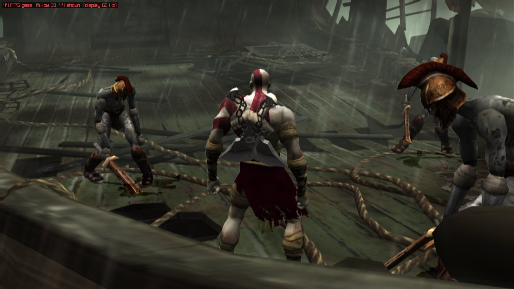
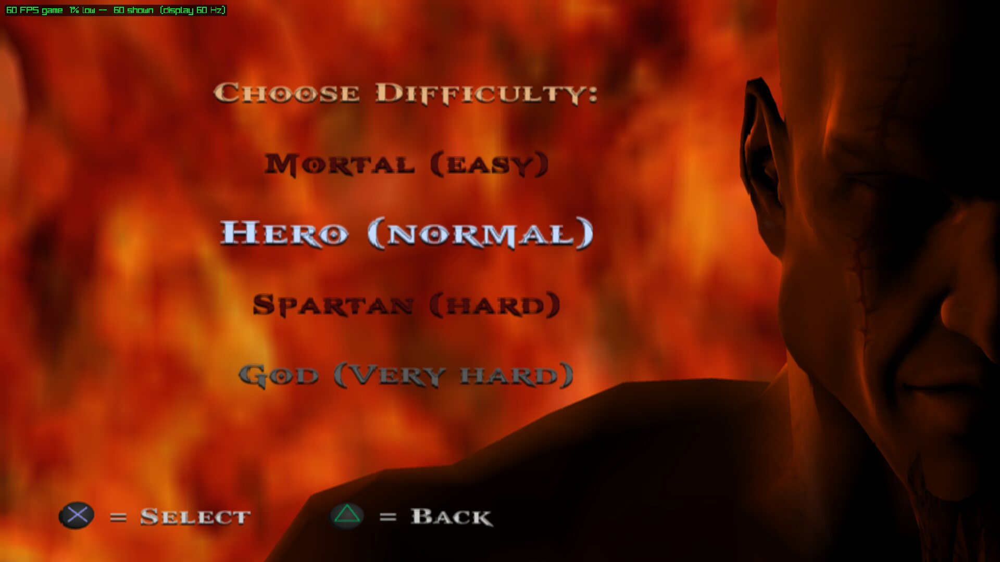
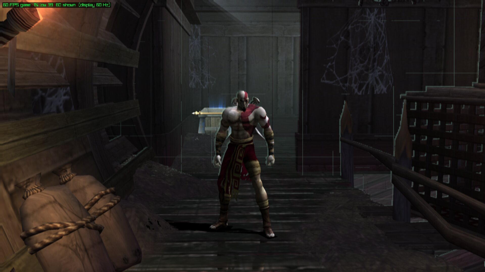
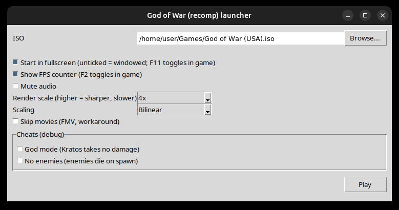
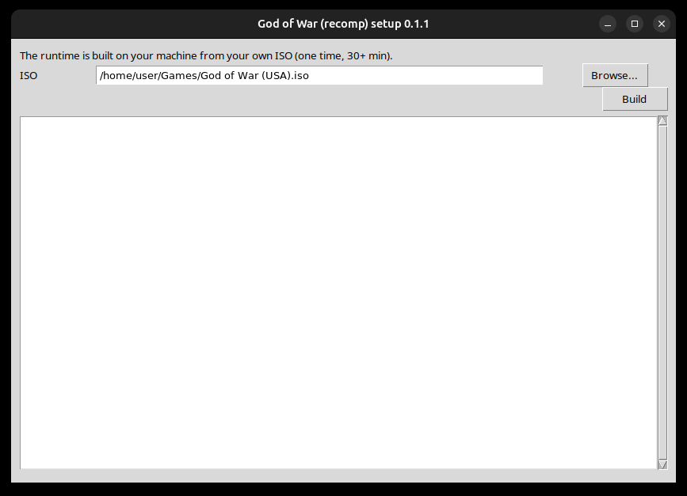
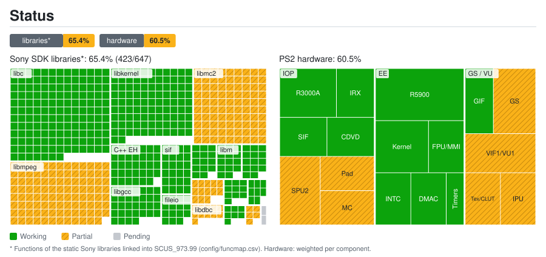
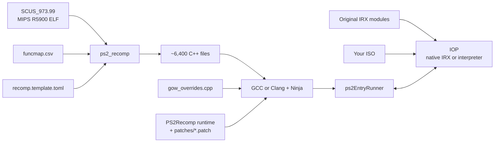

<div align="center">

# God of War — PS2 Static Recompilation for Linux

**A native Linux port of *God of War* (PS2, NTSC-U `SCUS-97399`) built by statically recompiling the game's MIPS R5900 code to C++.**


[](https://github.com/igormcsouza/god-of-war-recomp/actions/workflows/pruebas.yml)
[](https://playported.com/ports/337-god-of-war/)



</div>

---

> [!IMPORTANT]
> This repository **does not contain any game files** (ISO, executable, IRX modules or `.PAK` data),
> nor the C++ code generated from them. You need **your own legal copy** of God of War for the PS2.

## Contents

- [What is this?](#what-is-this)
- [Quick start](#quick-start)
- [Screenshots](#screenshots)
- [Current status](#current-status)
- [Repository layout](#repository-layout)
- [How it works](#how-it-works)
- [Documentation](#documentation)
- [Credits and license](#credits-and-license)

## What is this?

Instead of emulating the PlayStation 2, this project **translates the game's original executable (`SCUS_973.99`)
into C++** with [PS2Recomp](https://github.com/ran-j/PS2Recomp) and compiles it into a native Linux program. The base is
the runtime of [Waffle565](https://github.com/Waffle565/God-Of-War-Native-Port)'s native port, which replaces every
piece of PS2 hardware with native code that produces the same result from the game's own data:

| Layer | Native replacement |
|---|---|
| **EE CPU** (game code) | Static recompilation to C++ (6,414 functions) |
| **VU1** (vector microcode) | Microprograms compiled ahead of time to C++ |
| **GS** (graphics) | OpenGL render-target renderer, adjustable internal resolution (1080p by default) |
| **IOP** (I/O CPU) | The game's 8 IRX modules compiled ahead of time to C++ |
| **Sound** (SPU2) | Native sound engine driven by the game's LIBSD calls |
| **Pad / memory card** | Native services |
| **Disc** | Files read from your own ISO |

This repository holds everything specific to God of War: the function map, the recompiler configuration, the game
overrides, the runtime patches (one per topic, in [`patches/`](patches/)), the Linux launcher, the setup wizard and the
AppImage builder.

## Quick start

**Easiest — the AppImage.** Download the `.AppImage` from the [releases](../../releases) and run it. It contains no game
data: the first time it builds the runtime from your own ISO (30+ minutes, depending on your CPU), installs the missing
build packages itself, and then opens the launcher. See [`manual/install/appimage.md`](manual/install/appimage.md).

**From source.** You need GCC or Clang, CMake, Ninja, Git, Python 3 with Tk and an OpenGL 4.x GPU:

```sh
python3 scripts/compilar_linux.py --elf /path/to/SCUS_973.99           # build (slow the first time)
python3 tools/linux/capture_microcode.py --iso "God of War (USA).iso"  # once, unattended, ~5 min
python3 scripts/compilar_linux.py --elf /path/to/SCUS_973.99           # rebuild with full-speed VU1/IOP
python3 tools/linux/gow_launcher.py                                     # settings window and Play
```

The capture step saves the game's VU1 microprograms and IRX modules from your own ISO, so the build can compile them
(without it the VU1 is interpreted, about 10 FPS). The full guide is in
[`manual/install/from-source.md`](manual/install/from-source.md) and
[`manual/reference/linux-build-details.md`](manual/reference/linux-build-details.md).

In game, **F2** shows the FPS meter, **F11** toggles fullscreen and windowed, and pads without an SDL mapping get a
generic Xbox-like layout (`GOW_PAD_DIAG=1` shows what the game reads). See [controls](manual/usage/controls.md) and the
[environment variables](manual/usage/env-vars.md).

## Screenshots

<p align="center">
  
  
</p>
<p align="center">
  
  
</p>

More in the [gallery](manual/usage/screenshots.md).

## Current status

<a href="manual/status-map/detalle.en.md"></a>

Per-library and per-component breakdown: [`manual/status-map/detalle.en.md`](manual/status-map/detalle.en.md). Regenerated from
`manual/status-map/datos.toml` by `tools/estado/generar.py` (and automatically on push to `main`).

| Milestone | Status |
|---|:---:|
| `SCUS_973.99` recompiled to C++ and native executable | ✅ |
| Boot, menus, new game, combat, audio, movies with sound | ✅ |
| Native VU1 and IOP (every block without the interpreter) | ✅ |
| Save and load from a memory card | ✅ |
| Linux: about 55-60 fps in gameplay on an RTX 5050 laptop, 1080p render scale | ✅ |
| AppImage that builds from your own ISO | ✅ |
| Full playthrough | ⏳ pending |
| PAL languages | ⏳ on hold |

Details and numbers, including what was not verified, are in
[`manual/reference/research-log.md`](manual/reference/research-log.md); version history is in [`CHANGELOG.md`](CHANGELOG.md).

## Repository layout

```
.
├── .github/workflows/            # CI: tests (pruebas.yml), status map (estado.yml), manual, release
├── AGENTS.md                     # Project conventions for contributors and agents
├── config/
│   ├── funcmap.csv               # Function map (name, start, end, size)
│   └── recomp.template.toml      # PS2Recomp configuration (@ELF@, @MAP@, @OUT@)
├── manual/                       # The manual (MkDocs): install, usage, project, reference
├── patches/
│   ├── PS2RECOMP_COMMIT          # The PS2Recomp commit the patches apply on
│   ├── series                    # The patches, in the order they are applied
│   └── ps2recomp-*.patch         # The runtime and our fixes on top, one patch per topic
├── scripts/
│   ├── compilar_linux.py         # Prepares PS2Recomp, applies the patches and builds
│   └── medir_fps.sh              # Scripted FPS measurement
├── src/
│   ├── gow_overrides.cpp         # Game-specific overrides
│   └── *.h                       # Tested formats and helpers (libpad2 packet, pad script, cheats, GS replay)
├── tests/                        # Game-independent tests and known suite failures
└── tools/
    ├── appimage/                 # AppImage builder
    ├── ci/                       # CI helpers (patch order, config, tests)
    ├── estado/generar.py         # Status map generator
    ├── gs/                       # GIF packet inspector
    ├── iop/iopn_gen.py           # Compiles the game's IRX to C++ (native IOP)
    ├── linux/                    # Launcher, setup wizard, microcode capture
    └── vu1/                      # Compiles the VU1 microcode to C++ (native VU1)
```

## How it works



More details in [`manual/reference/architecture-details.md`](manual/reference/architecture-details.md).

## Documentation

All documentation is in the manual in [`manual/`](manual/), built with MkDocs and published at
<https://igormcsouza.github.io/god-of-war-recomp/> (`mkdocs serve` to read it locally). Start with:

- [Install with the AppImage](manual/install/appimage.md) and [build from source](manual/install/from-source.md)
- [Launcher](manual/usage/launcher.md), [controls](manual/usage/controls.md), [environment variables](manual/usage/env-vars.md) and [screenshots](manual/usage/screenshots.md)
- [How it evolved](manual/project/evolution.md), [performance](manual/project/performance.md) and [architecture](manual/project/architecture.md)
- [Research log](manual/reference/research-log.md): the detailed investigation record, known issues and next steps
- [`AGENTS.md`](AGENTS.md): conventions for contributors and coding agents
- [`CHANGELOG.md`](CHANGELOG.md): version history

## Credits and license

- [**KIexster/god-of-war-recomp**](https://github.com/KIexster/god-of-war-recomp) — the original project this one started from: the recompiler configuration, the function map and the first overrides.
- [**PS2Recomp**](https://github.com/ran-j/PS2Recomp) by ran-j and contributors — recompiler and runtime (GPL-3.0).
- [**God-Of-War-Native-Port**](https://github.com/Waffle565/God-Of-War-Native-Port) by Waffle565 — the native runtime (GS, VU1, IOP, sound, DMA, disc), overrides and tools that are the base of the port.
- [**PCSX2**](https://github.com/PCSX2/pcsx2) contributors — the EE interpreter and VU operations of the runtime (`ee_ref/`, `vu_pcsx2/`, brought in with Waffle565's runtime) (GPL-3.0+).
- [**SotC runtime fork**](https://github.com/LightVelox/PS2Recomp/tree/ac9efa070638ad3b3accd284de6f898d5ab271d1) by Taylor N. Albarnaz / LightVelox — EE fixes (FPU, 64-bit branches, LQ/SQ, tail jumps, VU0 macro mode and long DMA chains) (GPL-3.0, `ac9efa0`).
- *God of War* © Sony Interactive Entertainment / Santa Monica Studio. This project is not affiliated with
  or endorsed by Sony. No game content is distributed.

The code in this repository is released under the **GPL-3.0** license, consistent with PS2Recomp.
See [`LICENSE`](LICENSE).
