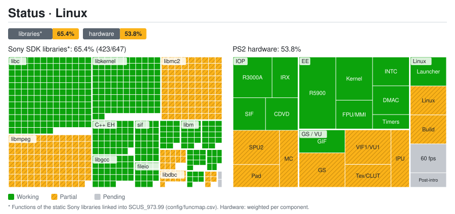
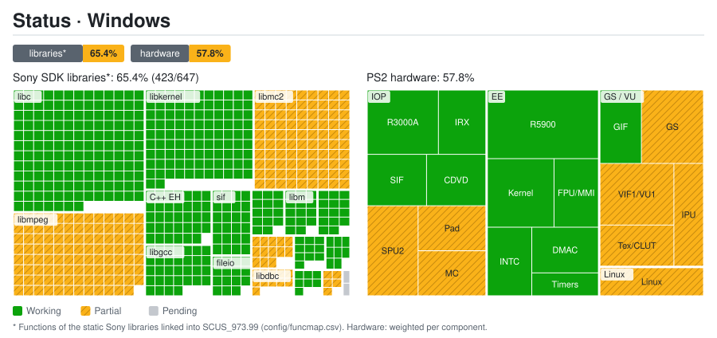

# Port status: details

Generated by `tools/estado/generar.py` from `docs/estado/datos.toml` and `config/funcmap.csv`. Do not edit by hand.

## Summary

| Platform | Sony SDK libraries* | PS2 hardware |
|---|---:|---:|
| Linux | 65.4% (423/647) | 53.8% |
| Windows | 65.4% (423/647) | 57.8% |

## Sony SDK libraries*

| Library | Functions | Windows | Linux | Note |
|---|---:|---|---|---|
| `libmpeg` | 103 | 🔧 Partial | 🔧 Partial | The FMV intro is software-decoded and plays through (synchronous MPEG stream callbacks); other videos remain unverified; GOW_SKIP_FMV skips movies **Linux:** The FMV intro plays through after the synchronous-callback fix (screenshots up to the 'Three Weeks Earlier' card); other videos unverified; the screen after the cutscene can hang (pending); GOW_SKIP_FMV=1 (launcher option) skips movies |
| `libipu` | 5 | 🔧 Partial | 🔧 Partial | sceIpuInit fixed; the software MPEG path works, but full IPU operation coverage is unverified |
| `libgraph` | 7 | ✅ Working | ✅ Working |  |
| `libdma` | 8 | ✅ Working | ✅ Working |  |
| `libcdvd` | 10 | ✅ Working | ✅ Working | Reads the original ISO |
| `libdbc` | 11 | 🔧 Partial | 🔧 Partial | dbcman RPC and SIO2 verified for card loading and saving; SIO2 controllers still read as disconnected |
| `libpad2` | 13 | 🔧 Partial | 🔧 Partial | HLE for the first port (keyboard or gamepad, controller autodetected on Linux); pressures 0/255 **Linux:** HLE for the first port; controller autodetected (indices 0-3, GOW_PAD_INDEX) with a generic SDL mapping for unmapped pads; pressures 0/255; second port disconnected |
| `libvib` | 2 | ⏳ Pending | ⏳ Pending | No rumble: the HLE reports no actuators |
| `libmc2` | 90 | 🔧 Partial | 🔧 Partial | Listing, loading, saving and reloading verified with a copied 8 MB PCSX2 card with ECC; formatting and reopening in PCSX2 remain unverified |
| `libscf` | 14 | ✅ Working | ✅ Working |  |
| `libgcc` | 32 | ✅ Working | ✅ Working |  |
| `C++ EH` | 34 | ✅ Working | ✅ Working |  |
| `libm` | 14 | ✅ Working | ✅ Working |  |
| `libc` | 150 | ✅ Working | ✅ Working |  |
| `libkernel` | 101 | ✅ Working | ✅ Working |  |
| `sif` | 24 | ✅ Working | ✅ Working | SIF commands and RPC |
| `fileio` | 15 | ✅ Working | ✅ Working |  |
| `loadfile` | 14 | ✅ Working | ✅ Working | IOP heap and module loading |

## PS2 hardware

| Group | Component | Weight | Windows | Linux | Note |
|---|---|---:|---|---|---|
| EE | R5900 CPU (recompiled to C++) | 5 | ✅ Working | ✅ Working |  |
| EE | Kernel: threads, semaphores and alarms | 3 | ✅ Working | ✅ Working |  |
| EE | FPU (COP1) and MMI instructions | 2 | ✅ Working | ✅ Working |  |
| EE | INTC: VSync and GS interrupt | 2 | ✅ Working | ✅ Working |  |
| EE | DMA controller | 2 | ✅ Working | ✅ Working | fromSPR/toSPR chains now copy the bone palette; Kratos and enemy shapes verified in gameplay |
| EE | Timers | 1 | ✅ Working | ✅ Working |  |
| GS / VU | GS: primitives and framebuffer | 3 | 🔧 Partial | 🔧 Partial | CPU reference and a Vulkan compute backend (byte-identical to the CPU, default on Linux) plus OpenGL on Windows; ship, Kratos, enemies and HUD visible; some texture-feedback primitives still fall back to the CPU; visual glitches on orbs/particles; coverage remains incomplete **Linux:** Vulkan compute backend by default (byte-identical to the CPU in tests; the OpenGL context is a stub on Linux); ship, Kratos, enemies and HUD visible; some texture-feedback primitives still fall back to the CPU; visual glitches on orbs/particles; ~20-30 fps in gameplay |
| GS / VU | VIF1 and VU1 | 3 | 🔧 Partial | 🔧 Partial | VU1 microcode compiled to C++ (blocks with static timing, bit-identical to the interpreter in record/replay tests); needs a local microcode capture; in gameplay the VU1 thread is still one of the speed limits; coverage remains unverified |
| GS / VU | GS: textures, CLUT and fonts | 2 | 🔧 Partial | 🔧 Partial | HUD visible; CPU/OpenGL bilinear and nearest STQ verified, including signed 16.16 boundaries, against procedural PCSX2 software patterns; GPU feedback stable in an experimental mode; regional texture batches optimized and verified across all 13 PSMs; real GS cache and full font/CLUT coverage remain unverified |
| GS / VU | GIF (PATH1-3) | 2 | ✅ Working | ✅ Working |  |
| GS / VU | IPU: FMV video | 2 | 🔧 Partial | 🔧 Partial | The FMV intro works through software MPEG decoding; this does not establish complete IPU hardware emulation **Linux:** The FMV intro works through software MPEG decoding with synchronous stream callbacks (fix verified with screenshots); this does not establish complete IPU hardware emulation; hang after the cutscene pending |
| IOP | R3000A CPU (interpreter) | 3 | ✅ Working | ✅ Working | Opus idle scheduler integrated and validated with GS/VU1: caches the next wake-up; its profile reduces IOP from ~1300–1500 to ~570–650 ms per 5 s; an FPS comparison without concurrent builds remains pending |
| IOP | SPU2: audio output | 3 | 🔧 Partial | 🔧 Partial | Bank loading and continuous sound verified; streamed music no longer restarts every 0.36 s (CD read latency and SPU2 loop-jump fixes; verified from logs, not by ear); reverb and ADMA are missing **Linux:** The CD-latency and SPU2 loop fixes were checked on Linux from logs only (230 s menu run, audio muted; not by ear); reverb and ADMA are missing |
| IOP | Original IRX modules | 2 | ✅ Working | ✅ Working |  |
| IOP | SIF: EE ↔ IOP RPC and DMA | 2 | ✅ Working | ✅ Working |  |
| IOP | CDVD: reading the original ISO | 2 | ✅ Working | ✅ Working |  |
| IOP | DualShock 2 controller | 2 | 🔧 Partial | 🔧 Partial | libpad2 via HLE (first port); controllers read as disconnected on the emulated SIO2 **Linux:** libpad2 via HLE (first port); controller autodetected (generic mapping when SDL does not know it); buttons checked in play; no rumble; the emulated SIO2 still sees no controllers |
| IOP | SIO2: memory card | 2 | 🔧 Partial | 🔧 Partial | SIO2 and 8 MB card with ECC: loading, saving and reloading verified in-game on a PCSX2 copy; formatting and reopening in PCSX2 remain unverified |
| Linux | Native Linux port | 2 | 🔧 Partial | 🔧 Partial | Launcher (extracts the ISO, detects the controller, option to skip movies), Vulkan (compute) GS, compiled VU1 and the native build work; the compiled VU1 needs a local microcode capture; ~20-30 fps in gameplay (goal: 60); visual glitches on orbs/particles and a hang after the intro cutscene |
| Linux | Launcher and ISO preparation | 2 | — | ✅ Working | Extracts the ELF/IRX from the personal ISO and validates the hash; settings window (fullscreen, filter, controller, GPU, mute, skip movies); synthetic tests in CI (docs/LINUX_LAUNCHER.md) |
| Linux | Native build | 2 | — | 🔧 Partial | The runner builds and runs on Linux (scripts/compilar_linux.py); the compiled VU1 needs a local microcode capture (GOW_VU1_MICROCODIGO) and CI only builds the runtime without the ELF |
| Linux | Speed: 60 fps | 2 | — | ⏳ Pending | ~20-30 fps in gameplay (RTX 5050; goal 60): the exact compute GS caps around 25-30 fps and a hardware-style path is missing; no true 1080p (upscaling only) |
| Linux | Screen after the intro cutscene | 1 | — | ⏳ Pending | A hang after the intro cutscene is still not investigated (docs/PROGRESS_LOG.md, docs/ESTADO.md); GOW_SKIP_FMV=1 avoids it |

* Functions of the static Sony libraries linked into SCUS_973.99 (config/funcmap.csv). Hardware: weighted per component.
