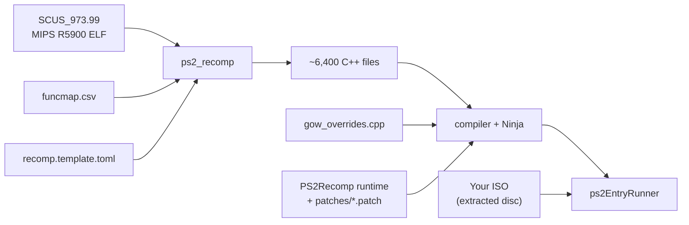

# Architecture

## Idea

The game executable `SCUS_973.99` is translated once into about 6,400 C++ functions (`ps2_recomp`), compiled together
with a **runtime** that replaces every PS2 chip with native code, plus a small set of game-specific overrides.

## Native replacement of every chip

| Layer | Native replacement |
|---|---|
| EE CPU (game code) | Static recompilation to C++ (6,414 functions) |
| VU1 (vector microcode) | Microprograms compiled ahead of time to C++ (`tools/vu1/vu1n_gen.py`); the exact interpreter stays as a fallback |
| GS (graphics) | OpenGL render-target renderer, 2x internal resolution, 16:9; texture/CLUT store instead of a VRAM model |
| IOP (I/O CPU) | The game's 8 IRX modules compiled ahead of time (`tools/iop/iopn_gen.py`) |
| SPU2 (sound) | Native engine driven by the game's LIBSD calls |
| Pad / memory card | Native services, no SIO2 model |
| DMA / VIF / GIF | Packets go straight to VU1 and the GS; DMA, timers and GS display registers become native calls |
| Disc | Files extracted from the disc, each at its original sector |

## The build pipeline

1. **PS2Recomp** is cloned at a pinned commit.
2. **Patches** in `patches/` are applied in the order listed in `patches/series` (checked by `tools/ci/parches.py`).
   One patch per topic. The base is Waffle565's runtime; ours go on top (pad mappings, English overlay, fullscreen, 1% low).
3. **Recompiler config**: `config/recomp.template.toml` lists stubs (Sony library functions the runtime implements
   natively), skips and instruction patches; `config/funcmap.csv` defines the 6,414 function boundaries.
4. **C++ generation** runs `ps2_recomp` on the ELF.
5. **Native IOP / VU1** code is generated from the captured IRX modules and microcode.
6. **Runtime build** compiles everything with `src/gow_overrides.cpp` into `ps2EntryRunner` (unity build + PCH, LTO link).

## Game overrides

`src/gow_overrides.cpp` registers replacements and diagnostics for individual game functions (the recompiler drops some,
others have no runtime handler, some are only logged). It always calls the original for what it does not replace.
Examples: `sceSifInitRpc`, `iWakeupThread`, `sceCdReadDvdDualInfo` (reports a dual-layer disc), the `989snd` command
sender, and the cheat hook (`src/gow_cheat.h`).

## Tests and CI

CI runs without the game: config validation, patch application, stub-handler check, compiling `src/*.cpp` against the
patched runtime, and the full `ps2x_tests` suite. Run the suite from `PS2Recomp/` (some tests read sources by relative path).

!!! info "More detail"
    The full translated architecture notes are in [Architecture details](../reference/architecture-details.md).
