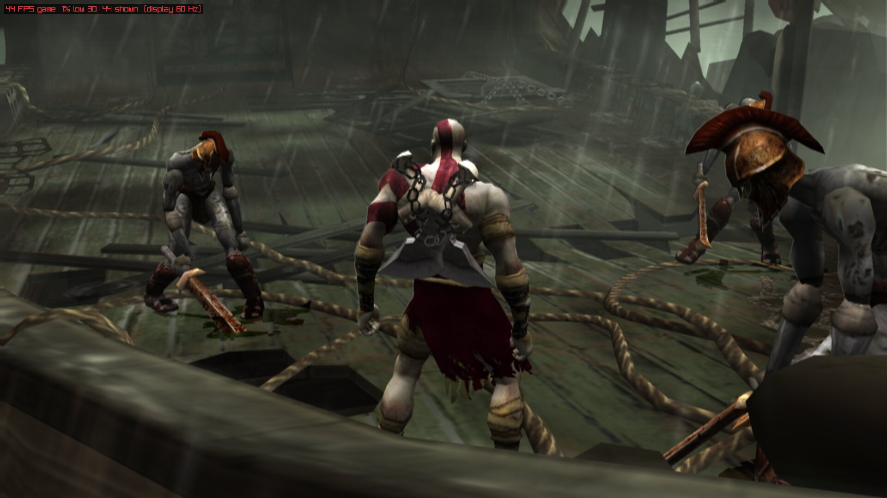
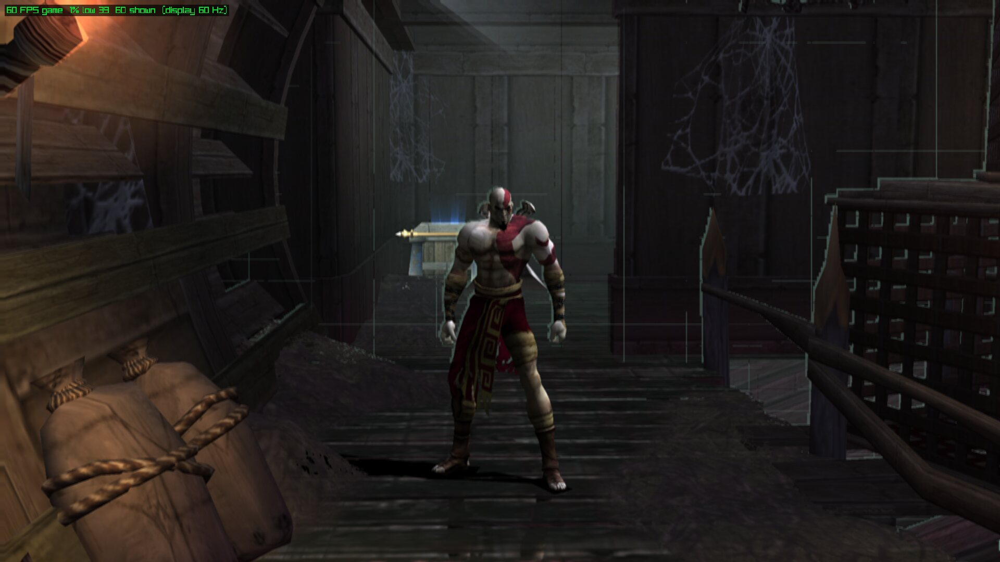
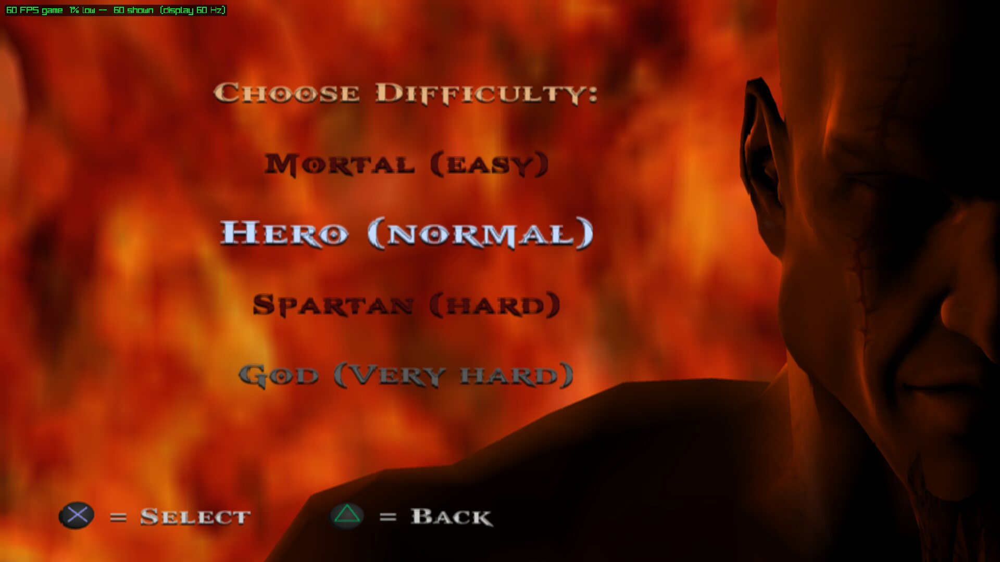
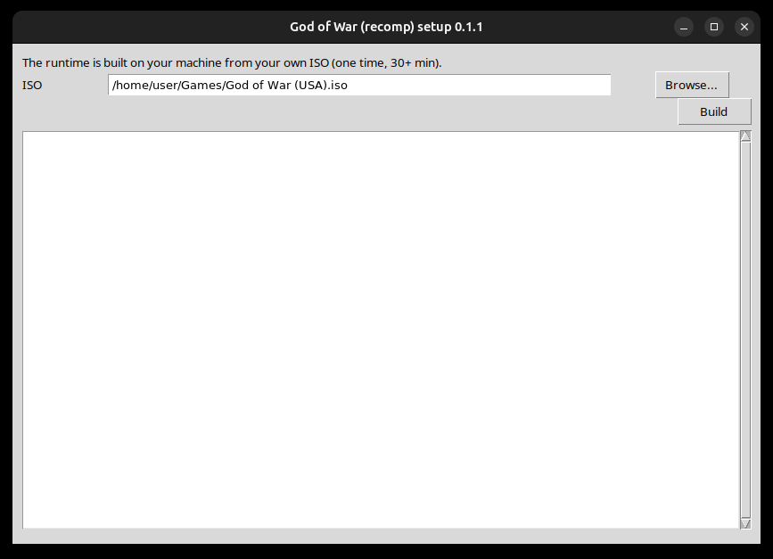
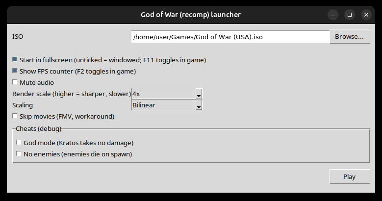

# Screenshots

Captured on Linux with the native runner at render scale 4 (the window is 1920×1080). The FPS counter in the top left
corner is the runtime's own overlay (**F2**).

## Gameplay

## Install and launch

The first-run setup wizard builds the runtime from your own ISO (30+ minutes, once):

The launcher sets fullscreen or windowed, the FPS counter, mute, render scale, scaler, movies and the debug cheats:

## Taking your own

- **Press F2** in game for the FPS meter and **F11** to go windowed, so the window is easy to grab.
- On X11 or XWayland, `import -window <id> shot.png` (ImageMagick) saves the game window losslessly; find the id with
  `xwininfo -root -tree | grep PS2-Recomp`. The desktop's own screenshot tool works too.
- `GOW_HOST_SHOT=<n>` makes the runtime write the window's picture at host frame `n` to `host_shot.png` in its working
  directory, with no desktop involved.
- For a steady, repeatable scene without touching the pad, see
  [scripted pad and reproducible scenes](../reference/controls-and-menu-tests.md).

!!! note
    Screenshots of the game show Sony's copyrighted artwork. They are included to document the port; the game itself is
    not distributed. See [Credits and legal](../project/credits.md).
